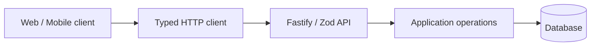

# Sustainability Management · Web

React 19 + Vite interface for sustainability operations. The repository contains routes for dashboards, inventory, preparation, sessions, reports, organizations and user management.

> **Portfolio disclosure:** Only source-visible capabilities are described here. This is not a claim of production readiness, successful CI, or measurable business impact. The API and mobile counterparts are separate repositories currently undergoing privacy and publication review.

## Technology

React, TypeScript, React Router, TanStack Query, Tailwind, Zod, Orval-generated HTTP client

## Architecture snapshot



The diagram is a conceptual integration view across the product family; deployments and connectivity have not been independently verified. See implementation references below for actual repository code.

## Inspect the source

- [`src/pages/dashboard.tsx`](src/pages/dashboard.tsx)
- [`src/pages/estoque.tsx`](src/pages/estoque.tsx)
- [`src/pages/preparos.tsx`](src/pages/preparos.tsx)
- [`src/pages/relatorios.tsx`](src/pages/relatorios.tsx)
- [`src/pages/nucleos.tsx`](src/pages/nucleos.tsx)

## Run and validate locally

Install compatible runtimes and dependencies, configure environment values locally (never commit credentials), and run the available scripts:

```bash
yarn install --frozen-lockfile
yarn build
yarn lint
```

These are defined project scripts, **not** test results. The test/build environment, external services and credentials require their own setup.

## Engineering topics for technical review

- Module boundaries and validation at HTTP/UI boundaries.
- Typed integration between frontend/mobile and backend where available.
- Authentication, permissions and separation of personal or organizational data.
- Testability, reliability, error handling and dependency management.

## Evidence and security backlog

- [ ] Obtain approval to publicly display project branding and domain-specific information.
- [ ] Complete Git history scan for credentials, private URLs and personal information.
- [ ] Create safe seed/demo data and real anonymized captures of screens or API examples.
- [ ] Verify clean installs and passing quality checks in automated CI.
- [ ] Add architecture decision records and reproducible measurements where supported.

No external deployment or adoption claims are made here.
