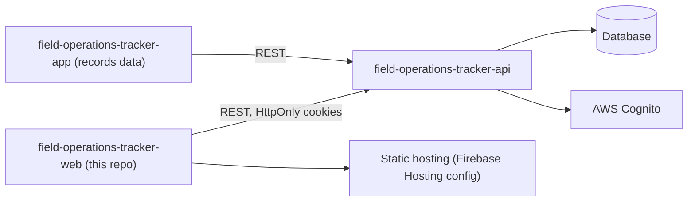
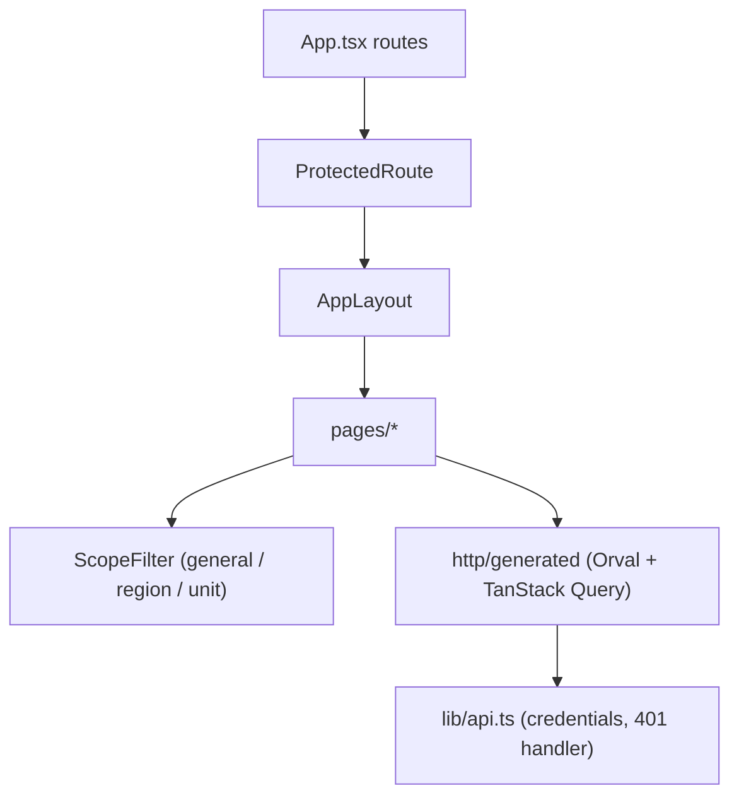

# Field Operations Tracker Web

Read-only React admin panel for a field data tracking system: it shows sessions, preparations, stock and consolidated reports for the regions and units a user is allowed to see.

Status: working panel built for a private organisation; not published as an open product. Records are created in the mobile app; this panel is for consultation.

## What it does

- Cookie-based sign-in against the backend, with automatic redirect to login on 401 (`src/hooks/use-auth.tsx`, `src/lib/api.ts`).
- Permission-gated routes: only users with a region-viewing permission or administrator reach the panel (`src/components/protected-route.tsx`, `src/lib/permissions.ts`).
- Scope filter (general, region, unit) that mirrors the backend's visibility levels (`src/components/scope-filter.tsx`).
- Pages for dashboard, users, regions, units, sessions, preparations, stock, reports and settings (`src/pages/`).
- Public privacy and support pages.
- Typed API client generated from the backend's OpenAPI spec (`orval.config.ts`).

## Architecture





- Single-page app with no business rules of its own: scope and permission decisions are enforced by the API; the UI only hides what the user cannot request.
- All server state goes through TanStack Query hooks generated from the API schema.
- The stock endpoint is not yet covered by the generated client, so it has a small hand-written hook (`src/http/vegetal.ts`).

## Key engineering decisions

- HttpOnly cookies instead of tokens in browser storage; the Axios instance sends credentials and a global handler logs the user out on 401 (`src/lib/api.ts`).
- Users, units and regions are provisioned through the identity provider, so the panel is deliberately read-only (`src/pages/usuarios.tsx`, `src/lib/permissions.ts`).
- Permission names are shared constants matching the backend, with administrator as a superset (`src/hooks/use-auth.tsx`).
- The API base URL is injected at build time through Vite `define`, so the Orval mutator works both inside and outside Vite (`vite.config.ts`, `src/lib/api.ts`).
- Generated client is committed under `src/http/generated/`; regenerate with `yarn generate:api`.

## Tech stack

React 19, TypeScript 6, Vite 8, React Router 7, TanStack Query 5, Tailwind CSS 4, Radix UI, React Hook Form, Zod 4, Axios, Orval.

## Getting started

Prerequisites: Node 20+, Yarn, a running backend ([field-operations-tracker-api](https://github.com/mkwitko/field-operations-tracker-api)).

```bash
yarn install --frozen-lockfile
cp .env.example .env
yarn dev
yarn build
```

| Variable | Purpose |
| --- | --- |
| `VITE_API_URL` | Base URL of the backend API (also used by `yarn generate:api`) |
| `VITE_CONTACT_EMAIL` | Contact e-mail shown on the privacy and support pages (optional) |
| `VITE_LEGAL_ENTITY` | Responsible organisation name shown on the privacy page (optional) |

## Testing

No automated tests. `yarn build` (type-check and bundle) succeeds locally. `yarn lint` reports 5 errors that have not been fixed.

## Project structure

```text
src/pages/        route screens
src/components/   layout, route guard, scope filter, UI primitives
src/hooks/        auth context
src/http/         Orval-generated client, manual stock hook
src/lib/          Axios instance, permissions, helpers
```

## Related repositories

- [field-operations-tracker-api](https://github.com/mkwitko/field-operations-tracker-api): backend API.
- [field-operations-tracker-app](https://github.com/mkwitko/field-operations-tracker-app): Expo mobile client.

## License

All rights reserved. Source available for portfolio review.
